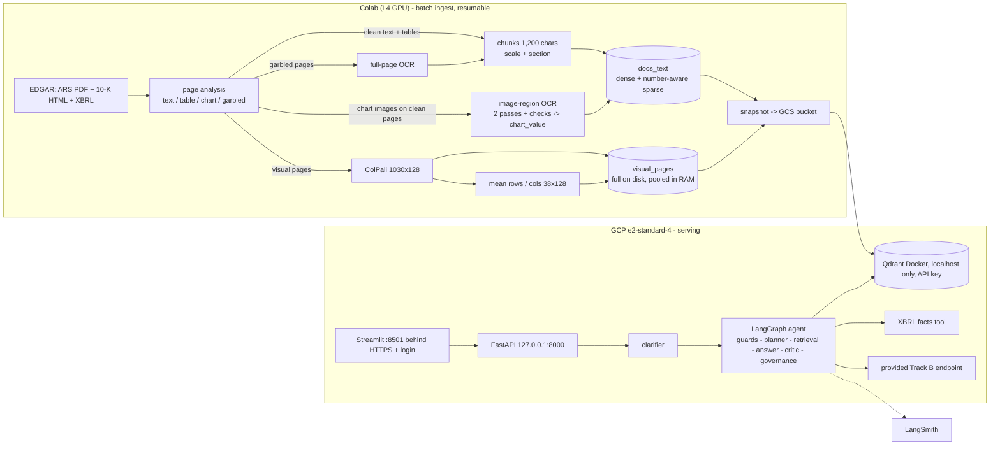

# Agentic Multimodal RAG Capstone: Final Architecture, Budget and 15-Day Plan

Revised 2026-11-05.
- **Replaces:** the earlier draft (Gemini 1.5 Flash, a single Qdrant collection, 20 days).
- **Basis:** the code on branch `finance_report_qa_agent`, measurements on this corpus, and prices checked on 2026-11-05 (sources at the end).
- **Labels:** **measured** = run in this project; **verified** = checked against a current source; **estimate** = not yet measured.

---

## 1. Constraints and decisions

| Item | Decision | Why |
|---|---|---|
| Deadline | **15 days** (2026-11-05 → 2026-11-19) | |
| Budget | **≤ ₹5,000**. Planned ≈ **₹2,565 with Google AI Pro** (Colab units and storage included), or ≈ ₹3,575 without | Section 2 |
| Answer LLM | **The provided Track B hosted ≤8B endpoint** (`LLM_API_BASE`/`LLM_API_KEY`/`LLM_MODEL`) | Track B allows only this model for generation. **Gemini 1.5 Flash was also retired on 2025-09-24** (verified) |
| Gemini | **Not in the answer path.** Google AI Pro covers the Gemini *app* only; the Gemini **API** is billed separately per Cloud project. Optional uses only if course staff approve (section 2.3) | AI Pro doesn't include API credits or raise API limits (verified) |
| Images to the LLM | **No.** Chart and table numbers reach the LLM as text (native PDF text, OCR, XBRL). Page images are shown to the user in Streamlit | The provided model is assumed to be text-only. If it accepts images, add that as an extra path |
| Corpus | **100 EDGAR ARS filings** (27 companies, FY2022–26, 14,701 pages) plus 10-K HTML, proxies and XBRL (downloaded, 1.8 GB). Scale to 250 only if days 6–7 leave time | 500 ARS PDFs would need ~100 more companies: EDGAR has ARS only since 2023, ~4 per company |
| Ingest | Google Colab, **L4 GPU** (A100 if available and the session is short) | Burn rate (verified): L4 ~1.7 CU/h, A100 ~5.4 CU/h |
| Serving | One **GCP `e2-standard-4`** VM (4 vCPU, 16 GB) in `us-central1`, running Qdrant (Docker), FastAPI and Streamlit | Measured RAM fits (section 3.3). Mumbai costs 20% more ($0.161 vs $0.134/h) |
| Observability | **LangSmith** (already built in, free tier) | Adding Langfuse would cost about a day for no benefit |

---

## 2. Budget (confirmed under ₹5,000)

Converted at ≈ ₹88/US$. GCP invoices to Indian accounts add **18% GST**; Google Play and Google One prices in India normally include tax.

**Compute need:** ~45 Colab compute units in total:
- tests ~10 CU;
- 100 filings ~6–10 CU on an L4;
- reruns and an optional 250-filing run ~25 CU.

### 2.1 Primary plan: with Google AI Pro (already subscribed; not counted)

AI Pro reportedly adds **~200 Colab compute units a month** (one third-party source; confirm on day 1) and includes **2 TB of Google storage**. That covers both Colab and Drive.

| Item | Plan | Basis | ₹ |
|---|---|---|---|
| Colab compute | AI Pro units (~200/month); ~45 needed | Confirm in Colab under *Resources* on day 1 | 0 |
| Drive | AI Pro 2 TB | included | 0 |
| GCP VM | `e2-standard-4`, us-central1, **~100 running hours** (spot on setup days, on-demand for evaluation and demo) | $0.134/h on-demand, ~$0.07–0.08/h spot (verified) | ~1,180 |
| GCP disk | 50 GB `pd-balanced`, **~2 months** (billed even while the VM is stopped; keep it until grading) | ~$0.10/GB-month | ~880 |
| GCP external IP and GCS | IP only while running (100 h); ~20 GB snapshot bucket in the same region for 2 months | ~$0.005/h IP; ~$0.02/GB-month | ~115 |
| GST on GCP (18%) | on ₹2,175 | | ~390 |
| LLM and embeddings | Provided endpoint and local MiniLM | | 0 |
| **Planned total** | | | **≈ ₹2,565** |
| **Buffer** | `e2-highmem-4` if RAM is tight (+~₹500 for 100 h), the optional Gemini API line (section 2.3), or more VM hours | | **≈ ₹2,435** |

### 2.2 Fallback: if the AI Pro Colab units don't appear

| Change from 2.1 | ₹ |
|---|---|
| Colab: 1 × pay-as-you-go 100 CU ($9.99, valid 90 days; price verified) | +880 |
| Drive: only if AI Pro storage isn't on the same Google account; Google One 100 GB for 1 month (₹130/month, verified) | +130 |
| **Total** | **≈ ₹3,575** (buffer ≈ ₹1,425) |

### 2.3 Optional: Gemini API (only with course-staff approval; not in the answer path)

| Possible use | Model | Estimate (~3,500 calls, ~9M input / 1M output tokens; Batch API for evaluation) | ₹ incl. GST |
|---|---|---|---|
| LLM-as-judge for free-text eval answers | Gemini 2.5 Flash-Lite, paid tier ($0.10 / $0.40 per 1M tokens) | ~$1.30 | ~135 |
| Same, with a stronger model | Gemini 3.1 Flash-Lite ($0.25 / $1.50) or 2.5 Flash ($0.30 / $2.50, turn thinking off) | ~$4–8 | ~390–830 |
| Chart reader at ingest (counted only when OCR and the geometry checks agree) | Flash-Lite | a few hundred calls | < 50 |

**Notes:**
- **The free tier isn't suitable.** Daily limits are reported anywhere from ~20 to ~1,500 requests (check your AI Studio console), and free-tier data is used to improve Google's products.
- **Set a spending cap** if you enable this. The worst case (2.5 Flash) still keeps the total under ₹5,000: ₹2,565 + ₹830 = ₹3,395.

### 2.4 Notes

- **GCP free trial:** new accounts get a $300 trial, which brings the GCP lines to ₹0 (total ≈ ₹0 with AI Pro).
- **AI Pro student offer:** the free offer for Indian students closed on 2025-09-15 and is not assumed here. The plan assumes your existing paid AI Pro subscription.
- **Gemini CLI / Code Assist** for AI Pro stops on **2026-06-18**, moving to Antigravity. It isn't used in this plan.

**Cost controls (day 2):**
- Set a GCP **budget alert at ₹3,000 and ₹4,000**.
- Stop the VM every evening.
- Delete the VM and disk after grading.
- Check Colab's Resources tab for the live burn rate.

---

## 3. Final architecture



### 3.1 Qdrant schema

This is what `scripts/rag/financial_ingest_qdrant_db.py` creates. It replaces the first draft's single collection.

| Collection · vector | Shape / type | Index | Storage | Purpose |
|---|---|---|---|---|
| `docs_text` · `dense` | 384-d (MiniLM) cosine | HNSW m=16 | RAM | meaning |
| `docs_text` · `bm25` | sparse, IDF, number-aware (`391,035` = `391035`) | sparse | default | exact figures and names |
| `visual_pages` · `mean_rows`, `mean_cols` | 38 × 128 multivector, MaxSim, float16 | HNSW | RAM | first stage |
| `visual_pages` · `colpali` | 1030 × 128 multivector, MaxSim, float16 | **m=0 on this vector only** | disk (mmap) | exact rerank |
| `visual_pages` · `summary` | 384-d cosine | HNSW | RAM | text side of visual search |

**Payload indexes:** `ticker` (tenant), `fiscal_year`, `doc_id`, `filing_id`, `section`, `content_type`. Payload is stored on disk.

**Deliberately not used:**
- a single global mean vector;
- binary quantization (published loss: −0.04 NDCG);
- collection-wide `m=0`, which turns off every index;
- stored PNGs (pages are rendered on demand).

### 3.2 Retrieval

- **Text:** dense + sparse prefetch (50 each) → Qdrant RRF → rerank by RRF + term overlap, or by the cross-encoder when `RAG_RERANKER_MODEL` is set, filtered by company and year.
- **Visual:** `mean_rows`, `mean_cols` and `summary` prefetch (200 each) → exact MaxSim on the full vectors.
- **Fusion:** text and visual results are fused with RRF (`retrieve_for_agent`).
- **Figures:** come from the XBRL facts tool first (section 5, day 4).

### 3.3 Serving sizing (measured on CPU, 4 threads)

| Item | Measured |
|---|---|
| ColPali query encoding, **float32** | **1.3–3.8 s** warm; **24–51 s first query** (warm up at startup) |
| ColPali query encoding, bfloat16 on CPU | 10–17 s warm; 132 s first. **Don't use bfloat16 on CPU** |
| ColPali peak RAM (float32) | **7.5 GB** |
| Qdrant RAM (100 → 500 filings) | ~0.2 → ~1.1 GB fixed; full vectors are read from disk |
| Total RAM expected on the VM | ~11–12 GB of 16 GB. Add 4 GB swap. Fallback: `e2-highmem-4` |
| Disk on the VM (100 filings) | Qdrant ~2 GB + PDFs 1 GB + models ~7 GB + OS ~10 GB → **50 GB is enough** |
| Text-only answer latency | Retrieval ~0.1–0.3 s plus 3–4 LLM calls on the provided endpoint (**estimate**) |

### 3.4 Verification status

| Component | Status | How it was checked |
|---|---|---|
| EDGAR download (PDF, 10-K, proxy, XBRL) | ✅ 100/100 filings | measured run; tests |
| Page analysis, chunking, number-aware sparse, hybrid search + rerank | ✅ | tests; notebook 02 on 4 filings |
| OCR of garbled pages | ✅ CPU (4.5 s/page). Recovered 5 of 6 XBRL statement figures for Chevron FY2022 | notebook 03 |
| Chart-number OCR (two passes) | ✅ read 4 of 4 chart values, **plus a false "12,000"**. ❌ **not yet stored at ingest** | notebook 03 |
| ColPali + mean pooling | ✅ real model on CPU: 1024 + 6 vectors, pooled to 38; target page ranked first in 3 of 3 queries. ❌ **GPU batch run not yet done** | local check; notebooks 04–05 (fake encoder on CPU) |
| Qdrant **server** (gRPC, snapshot, restore, bulk indexing) | ❌ **never run against a server** | API calls checked only |
| Agent, guardrails, clarifier, FastAPI, Streamlit | ✅ with the mock LLM. ❌ **with the provided endpoint** | 266 tests; live API + Streamlit runs; notebook 05 (before the coverage checks) |
| Facts tool (XBRL) in the agent | ❌ the SEC lookup exists in the notebook helpers; not wired into the agent or API | — |
| Number grounding check in the API | ❌ Pydantic grounding exists in notebooks; not in the API | — |
| GCP deployment | ❌ | — |

**Known gaps found by the notebooks** (scheduled in section 5):
- **Chart numbers aren't indexed.** Numbers inside chart images on clean pages are never stored, so 0% are found in retrieval.
- **Question-style queries miss the figure.** The gold figure is in the top-5 evidence for only 17% of questions (the filing is found 100% of the time with filters). A facts tool is needed.
- **The classifier fallback is too narrow.** When the classifier returns no usable JSON, its keyword list refuses valid questions.
- **Fixed already:** three clarifier false positives and an input-guard miss ("ignore **your** previous instructions").
- **Fixed on 6 Nov:** missing companies, years and bank measures now get a plain "not available" reply with no figure, and answers citing the wrong company are withheld (tested with the mock LLM and stubbed search, not the provided endpoint).

---

## 4. Deployment runbook (GCP)

1. **Project and costs.** Create a project, enable billing and Compute Engine, and set budget alerts at ₹3,000 and ₹4,000.

2. **VM.** `e2-standard-4`, `us-central1-a`, Ubuntu 22.04 LTS, 50 GB `pd-balanced`. Use **spot** for days 2–8 and on-demand for days 9–15. Add 4 GB swap.

3. **Firewall: do not open 6333 or 8000.** Expose only HTTPS (443) to Streamlit through **Caddy with basic auth**, or use a Cloudflare Tunnel or IAP. Qdrant and FastAPI listen on `127.0.0.1` only.

4. **Qdrant.** Pin the **same version** as the Colab server; record `qdrant --version` on Colab.
   ```bash
   docker run -d --name qdrant --restart always -e QDRANT__SERVICE__API_KEY="$QDRANT_API_KEY" \
     -p 127.0.0.1:6333:6333 -p 127.0.0.1:6334:6334 -v /srv/qdrant:/qdrant/storage qdrant/qdrant:<same-tag>
   ```

5. **Index transfer.** On Colab:
   ```bash
   gcloud storage cp <snapshot> gs://<bucket>/
   ```
   On the VM:
   ```bash
   gcloud storage cp gs://<bucket>/* /srv/snap/
   # Docker can't read host file:// paths, so upload each snapshot through the REST API:
   curl -X POST -H "api-key: $QDRANT_API_KEY" -F "snapshot=@/srv/snap/docs_text-....snapshot" \
     "http://127.0.0.1:6333/collections/docs_text/snapshots/upload?priority=snapshot"
   ```
   Repeat for `visual_pages`. Copy `ingest.sqlite3` into `RAG_INGEST_DIR`; the runtime profile uses it to switch retrieval to Qdrant.

6. **App.** Clone the repo branch. Install the dependency list from `pyproject.toml` (CPU torch). Set these environment variables:
   - `QDRANT_URL=http://127.0.0.1:6333`
   - `QDRANT_API_KEY`
   - `RAG_INGEST_DIR=/srv/rag`
   - `LLM_*`
   - `RAG_FIN_VISUAL=1`

   Then run two **systemd** services:
   - `uvicorn scripts.api.api_app:app --host 127.0.0.1 --port 8000 --workers 1`
   - `streamlit run scripts/ui/api_streamlit_app.py --server.address 127.0.0.1`

   On start, run one warm-up visual query.

7. **Check.** `GET /health` must show `financial_backend=financial_vlm`. Run the clarifier conversation and one chart question.

---

## 5. 15-day plan

| Day | Work | Done when |
|---|---|---|
| **1** (Nov 5) | **Checks first:**<br>• In Colab (AI Pro account) confirm the compute-unit balance. If it's missing, buy one 100 CU pack (section 2.2).<br>• Email course staff about any optional Gemini use (section 2.3).<br>**Then:** push the branch. On a Colab L4, run notebooks 01–05 with the provided endpoint on 4 filings. Test snapshot → GCS → restore on a Colab Qdrant server | Units confirmed; GPU ColPali and OCR work; real template scores; restore verified |
| **2** | GCP: budget alerts, spot VM, Docker Qdrant, HTTPS proxy. Deploy the API and UI against the small index | Remote chat works end to end; RAM and latency measured |
| **3** | **Chart numbers at ingest:** image-region OCR, two passes plus axis and sum checks, stored as `chart_value` text chunks with the page and box | Notebook 03: chart values found in evidence > 0% |
| **4** | **XBRL facts tool** in the agent (from downloaded companyfacts), routed for figure questions; classifier fallback via the clarifier's slots | Single-figure eval items answered from the facts tool |
| **5** | **Number grounding check** in the API, which withholds unsupported numbers. Streamlit side-by-side view (answer + rendered cited page) | Tests; a UI screenshot |
| **6–7** | Full ingest of 100 filings on an L4 (text + OCR + chart values + visual) → snapshot → GCS. Optionally 250 filings | All filings `complete` in the ingest state |
| **8** | Restore the full index on the VM; serving test; hand-label 20 extra chart questions as a **separate** set (v1 stays frozen) | `/health` OK; extra labels done |
| **9–10** | Evaluation on the provided endpoint:<br>• Week 1 baselines (`prompt_baselines`, hosted);<br>• retrieval Hit@3/5 for text-only vs visual vs hybrid;<br>• agent accuracy by category and failure taxonomy;<br>• latency (p50/p95) | Result tables and failure examples |
| **11** | Fix the top 2–3 failures and re-evaluate once | Before/after table |
| **12** | Freeze the code. Record a 3–5 min demo video and capture LangSmith traces | Video + screenshots |
| **13–14** | Report and slides (architecture, measured results, cost, failures, limits) | Draft complete |
| **15** (Nov 19) | Buffer, final checks, submit. Stop the VM; snapshot to GCS | Submitted |

**Risks:**

| Risk | Likelihood | Mitigation |
|---|---|---|
| The provided endpoint is slow or rate-limited | medium | Evaluate on days 9–10 with resumable runs (`prompt_baselines` resumes); cache answers |
| No GPU on Colab | low (paid) | Run text + OCR on a CPU runtime and ColPali when an L4 is free; A100 as fallback |
| Snapshot restore fails | medium (untested) | Tested on day 1; fallback: re-ingest on the VM from the cached page analysis (text stage only) |
| VM RAM | low | 4 GB swap; `e2-highmem-4` from the buffer |
| Scope creep (250–500 filings) | medium | 100 filings is the committed scope; scale only if day 7 is free |

---

## 6. Sources (prices and status checked 2026-11-05)

- Colab pay-as-you-go 100 CU for $9.99, units expire after 90 days: [fastero.com](https://fastero.com/blog/google-colab-pro), [aicoolies.com](https://aicoolies.com/pricing/google-colab), [thundercompute.com](https://www.thundercompute.com/blog/colab-alternatives-for-cheap-deep-learning-in-2025)
- Colab burn rates (L4 ~1.71 CU/h, A100 ~5.4 CU/h): [mccormickml.com](https://mccormickml.com/2024/04/23/colab-gpus-features-and-pricing/), [besthub.dev](https://www.besthub.dev/articles/gemini-pro-subscription-unlocks-free-a100-gpu-access-on-google-colab-30b8f8910d64)
- GCP `e2-standard-4` ($0.134/h us-central1, $0.161/h asia-south1, spot ~$0.08): [devzero.io](https://www.devzero.io/instances/gcp/e2-standard-4), [gcloud-compute.com](https://gcloud-compute.com/e2-standard-4.html), [economize.cloud](https://www.economize.cloud/resources/gcp/pricing/compute-engine/e2-standard-4/)
- Gemini 1.5 Flash retirement (2025-05-27 / 2025-09-24): [discuss.ai.google.dev](https://discuss.ai.google.dev/t/gemini-1-5-flash-retirement-date/83258), [9to5google.com](https://9to5google.com/2025/02/18/gemini-model-picker-1-5-removed)
- Indian student AI Pro offer (closed 2025-09-15, 2 TB): [businesstoday.in](https://www.businesstoday.in/technology/news/story/students-in-india-can-get-free-gemini-ai-pro-plan-heres-how-to-get-it-484829-2025-07-16), [blog.google](https://blog.google/intl/en-in/company-news/technology/students-in-india-just-got-a-gemini-upgrade/), [etvbharat.com](https://www.etvbharat.com/en/technology/google-launches-one-year-free-ai-plus-plan-for-indian-and-global-college-students-enn26082002492)
- Google One 100 GB at ₹130/month: [freepressjournal.in](https://www.freepressjournal.in/tech/google-one-in-india-plans-benefits-is-it-worth-subscribing), [marix.app](https://marix.app/library/guides/google-one-via-india)
- AI Pro Colab units (~200/month, third-party) and Colab benefits in Google AI plans: [inside.com.tw](https://www.inside.com.tw/article/42497-google-ai-pro-colab-200-compute-units-a100-cli), [androidauthority.com](https://androidauthority.com/google-ai-plans-premium-colab-benefits-3715703)
- AI Pro doesn't raise Gemini API limits; API limits are per Cloud project: [ai.google.dev rate limits](https://ai.google.dev/gemini-api/docs/rate-limits), [androidcentral.com](https://www.androidcentral.com/apps-software/ai/google-ai-pro-plan-just-got-a-quiet-downgrade)
- Gemini CLI / Code Assist for AI Pro ends 2026-06-18: [Google FAQ](https://developers.google.cn/gemini-code-assist/resources/faqs?hl=en)
- Gemini API prices (2.5 Flash-Lite $0.10/$0.40; 2.5 Flash $0.30/$2.50; 3.1 Flash-Lite $0.25/$1.50; Batch −50%): [cloudzero.com](https://www.cloudzero.com/blog/gemini-pricing/), [morphllm.com](https://www.morphllm.com/gemini-api-pricing), [metacto.com](https://www.metacto.com/blogs/the-true-cost-of-google-gemini-a-guide-to-api-pricing-and-integration)
- Gemini free-tier limits (reports vary, ~20–1,500 requests/day): [scriptbyai.com](https://www.scriptbyai.com/gemini-api-free-tier-limits/), [tinkerllm.com](https://tinkerllm.com/blog/gemini-api-free-tier-limits-rate-quotas/)

Confirm prices on the official pages (cloud.google.com/compute/vm-instance-pricing, colab.research.google.com/signup, one.google.com) before buying.
