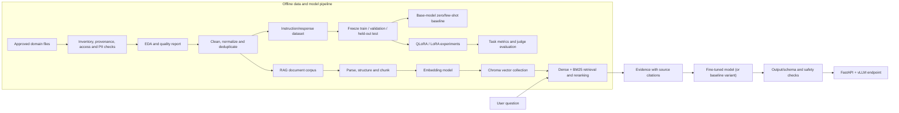

# Track 1 — Domain-Adapted Assistant (Model-Side / GPU)

This design corresponds to **Track A — Model-Side** in `Capstone-Templates-GenAI-Agentic-AI.pdf`. The deliverable is a domain-adapted open model, evaluated against its untuned baseline, grounded with retrieval, and served from the team's own endpoint.

## Relation to Agentic RAG

Track 1 is included as a reference for the model-side capstone path, but the implemented project follows Track B. In this repository, **Agentic RAG** means the retriever is not the whole application: retrieval is a tool inside a guarded LangGraph workflow with planning, tool execution, evidence checks, output filtering, citation validation, observability, and human-review routing. Track 1 can use RAG for grounding, but it becomes agentic only if those stateful planning, tool-use, critic, and governance steps are added around retrieval.

## 1. Goal and scope

Choose one narrow enterprise workflow (for example, IT helpdesk resolution, insurance claim triage, or SOP question answering). Build **800–2,000 instruction/response examples**, reserve **150–200 examples** for a never-trained-on test set, and use a separate domain corpus of **200–1,000 documents** for RAG. Keep the training examples and retrieval corpus conceptually separate: training teaches task behavior and format; RAG supplies changeable facts and evidence.

The required comparison is **base model**, **base + RAG**, **fine-tuned model**, and **fine-tuned + RAG**. Record the untuned zero-shot and few-shot baseline before training.

## 2. Architecture

## 3. Data workflow: read, inspect, clean, parse

1. **Inventory and permission:** list files, format, size, source, owner, department, effective date, confidentiality, and permitted use. Exclude content without an approved use or license. Keep source identifiers and an immutable raw snapshot.
2. **Read:** use format-specific loaders behind a common LangChain `Document` representation. Use `PyPDFLoader`/PyMuPDF for PDFs, `Docx2txtLoader` for DOCX, `UnstructuredHTMLLoader` or an HTML parser for web pages, and structured readers for CSV/XLSX/JSON. OCR scanned documents before treating them as text; retain page/sheet/record boundaries.
3. **EDA before modeling:** report file and format counts, document and page counts, extraction failures, empty/near-empty records, language, text length/token distributions, duplicates, date coverage, department/source coverage, missing fields, and PII incidence. For instruction examples, also inspect task/category balance, response lengths, schema validity, duplicates and train/test leakage. Manually inspect a sample of each source type and extraction failures.
4. **Clean:** normalize Unicode and whitespace, remove repeated headers/footers and navigation boilerplate, repair broken line wraps, normalize dates/units only when meaning is preserved, deduplicate exact and near duplicates, and flag malformed tables. Redact or de-identify PII before indexing or training. Do not discard negation, units, identifiers, section headings, or document version information.
5. **Parse:** preserve document hierarchy (title, headings, paragraphs, lists, tables, page/section). Convert tables into compact row/column text while retaining column names, or store them as structured records for exact lookup. Keep a mapping from every parsed section to its source/page/section.
6. **Freeze data:** create versioned corpus and example manifests with hashes, provenance, cleaning rules, and exclusion counts. Split instruction examples by source/document or entity when possible to prevent near-duplicate leakage; reserve the specified test set before any tuning. Do not put test-only answers into prompts, training, or retrieval.

## 4. Chunking and metadata

Start with **structure-aware chunking**: split on headings and paragraph boundaries, then use token-aware recursive splitting for oversized sections. A reasonable first experiment is roughly **400–700 model tokens per chunk with 50–100 tokens of overlap**; tune against retrieval recall and answer quality rather than treating these as fixed settings. Keep tables, procedures, definitions, and FAQs intact when they fit. For long manuals, compare parent/child retrieval: search small child chunks, then pass the containing section/parent text to the LLM.

Each chunk should have stable `chunk_id` and `document_id`, text, source URI/path, title, section path, page or record range, department/domain, document type, source/owner, effective and expiry dates, version, access-control labels, ingestion timestamp, content hash, parser/chunker versions, and corpus version. Store only metadata that is useful for citations, filtering, audit, or re-ingestion; do not put sensitive PII into searchable metadata.

## 5. Embeddings, vector store and indexing

- **Embedding recommendation:** start with `BAAI/bge-small-en-v1.5` for a compact English baseline; compare `BAAI/bge-base-en-v1.5` if GPU/RAM and latency allow. For a multilingual corpus, benchmark a multilingual embedding model such as `BAAI/bge-m3`. The embedding model is an encoder for text and queries, not the fine-tuned answer-generating LLM. Use the same model and normalization settings at ingestion and query time; changing it requires re-embedding the collection.
- **ChromaDB:** a good fit for this capstone's local, modest-sized corpus and fast iteration. Use a persistent client/collection, explicit embedding function, stable IDs and metadata, and cosine distance (confirm the collection's configured metric). Upsert in batches, checkpoint the source manifest, and make ingestion idempotent. Chroma's dense ANN index and metadata filters are useful, but Chroma alone is not a complete hybrid-search or multi-tenant access-control design.
- **Indexing:** create one collection per domain/corpus version or another explicit namespace scheme. Use HNSW approximate-nearest-neighbor indexing and metadata filters for department, effective date and allowed access labels. Build a BM25 index over the same chunk IDs. Keep exact identifiers, ticket numbers, product codes and names in a lexical/exact lookup path because dense similarity can miss them. For production multi-team scale or strict operational controls, benchmark Qdrant or pgvector rather than assuming a local Chroma deployment is sufficient.
- **Hybrid retrieval:** retrieve dense and BM25 candidates independently (initially 20–50 from each), combine ranks with reciprocal-rank fusion, then rerank the fused shortlist. A cross-encoder such as `BAAI/bge-reranker-base` or `cross-encoder/ms-marco-MiniLM-L-6-v2` is a starting point; benchmark it on domain queries. Return the best **3–6 evidence chunks** within the prompt token budget, with diversity by source/section where useful. Tune candidate count and final `k` on a held-out query set.
- **Fast top-k:** embed each query once; apply access/date/domain filters before vector search; use ANN rather than brute-force scoring; batch ingestion and query embeddings; cache repeated query embeddings/results only with a policy that accounts for access permissions and corpus version; avoid retrieving duplicate overlapping chunks. Measure retrieval latency and recall@k. Exact keyword search should run alongside—not after—dense retrieval.

### What “decoding” embeddings means

Vector embeddings are not reversibly decoded into their original sentences. Keep the original chunk text and metadata as records keyed by vector IDs. At query time, embed the query and find nearby vectors; fetch their stored text and metadata. The retrieved source text—not the vector—is what can be shown, cited, or placed in the prompt.

## 6. Multi-department queries and access

If a question spans departments, search the permitted department partitions and merge candidates by rank (for example, RRF), preserving department and source citations. Apply the user's authorization filter **before** retrieval and again before returning text; never retrieve broadly and rely on the LLM to hide unauthorized evidence. Use an explicit department/domain classifier only as a routing hint, with a safe cross-domain fallback when intent is ambiguous. Do not merge corpora with incompatible permissions or freshness rules. Log which sources and filters supported the answer.

## 7. RAG prompt and answer generation

The answer model is the selected, fine-tuned 7–8B instruct model. The brief names **Llama 3.1 8B Instruct**, **Qwen2.5 7B Instruct**, and **Mistral 7B Instruct** as baseline candidates. Choose one based on GPU availability, license/usage constraints, language, structured-output behavior, and task evaluation; Qwen2.5 7B is a practical first candidate for structured answers, not a guaranteed winner. The GPU-provided environment and the team's actual evaluation should decide.

The generation chain should:

1. Take the user question and retrieve/rerank evidence under authorization filters.
2. Fit only top-ranked, non-duplicate passages into a fixed context budget; preserve source IDs, titles and page/section.
3. Build a prompt with task instructions, required output schema, evidence clearly delimited as untrusted reference material, and a rule to abstain or state uncertainty when evidence is insufficient.
4. Require citations for factual claims and validate output/schema after generation. Do not treat document instructions as system instructions.
5. Return the answer with citations and, when useful, an explicit “not found in the indexed sources” response.

Use LangChain `Document` loaders, text splitters, embeddings, Chroma vector store, retrievers, prompt templates and runnable chains. Compose dense and BM25 retrieval with an ensemble/RRF step and a reranker. Use LangGraph only if the workflow genuinely needs stateful multi-step routing; Track 1 can remain a simpler retrieval-and-generation chain. Wrap inference with vLLM and FastAPI as required by the brief.

## 8. Fine-tuning and GPU model plan

1. Record zero-shot and few-shot baseline behavior before training; freeze prompts and test data.
2. Run supervised **LoRA/QLoRA with PEFT** on the train split, validate on a validation split, and log configuration, seed, GPU type/memory, runtime, losses and artifacts in MLflow or Weights & Biases.
3. Complete at least two materially different configurations (e.g. rank/learning rate/target modules/epochs) and one ablation. Avoid full-parameter tuning and pretraining. DPO on 200–300 preference pairs is optional only after core experiments are sound.
4. Compare the base model, tuned model, and their RAG variants using the same held-out examples and retrieval corpus. Fine-tuning should improve domain task behavior/schema/tone; it is not a substitute for current factual retrieval.
5. Merge/export the selected adapter and quantise to GGUF or AWQ/GPTQ as compatible with the chosen serving stack. Serve via vLLM behind FastAPI in a container; benchmark the actual exported model.

Every team member is expected to run at least one GPU training job per the brief. Confirm the supplied GPU memory and software environment before finalizing batch size, quantization and model choice.

## 9. Evaluation, safety and operations

Evaluate the **held-out 150–200 examples** with task-appropriate exact match/F1/ROUGE or domain-specific metrics, plus schema-validity rate. Add a documented LLM-as-judge rubric and human review of a sample; report judge agreement and known limitations. Evaluate retrieval separately (recall@k / MRR or nDCG on evidence-labeled queries), then end-to-end answer correctness, citation support, abstention, latency, throughput/tokens per second, and memory. Compare the four required model/RAG variants.

Run a 20-prompt red-team set covering prompt injection, unsupported claims, sensitive-data requests, malformed inputs and refusal boundaries. Keep audit logs of model, adapter, corpus/index versions, retrieved source IDs and latency while minimizing stored PII. Publish a model card with intended use, data provenance, limitations, failure modes and refusal behavior. Track experiments and reproducibility artifacts in MLflow or Weights & Biases.

## 10. Recommended implementation sequence (four weeks)

| Week | Workflow and exit gate |
|---|---|
| 1 | Select one domain; inventory and EDA; create and freeze 800–2,000 examples and the 150–200 held-out set; record zero/few-shot baseline. **Do not begin tuning until baseline and split are frozen.** |
| 2 | Run two or more QLoRA/LoRA configurations and one ablation; track experiments; compare on validation data. Attempt optional DPO only if core work is complete. |
| 3 | Parse and index 200–1,000 corpus documents; run chunking/embedding experiments; add hybrid retrieval and reranking; compare base + RAG, fine-tuned, and fine-tuned + RAG. |
| 4 | Finalize held-out evaluation and red-team report; merge/quantise adapter; deploy vLLM + FastAPI in Docker; produce model card, report and demo. |

