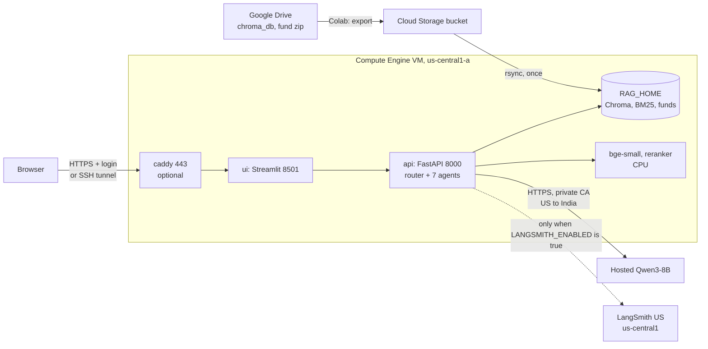

# Deploying FactFolio on Google Cloud for an end-to-end demo

Updated 24 November 2026 (first written 13 November). It covers Streamlit, FastAPI, the finished Chroma collection and the hosted Qwen3-8B on one Google Cloud VM: whether the free account is enough, how long it takes, what it costs, and the steps.

**Status: deployed on 27 November 2026.** Section 0 records what was actually built and how. Sections 1–12 are the original plan (24 November), kept as written; where the deployment differed, section 0 says so.

## 0. As deployed (27 November 2026)

FactFolio runs at **https://8-234-95-222.sslip.io** behind HTTPS and a login (user `factfolio`; the password is shared with evaluators privately).

| Item | Plan (sections 1–12) | As deployed |
|---|---|---|
| Region and zone | `us-central1-a` | **`asia-south1-a` (Mumbai)**: next to the course LLM endpoint, which answered a test call from the VM in 0.1–0.2 s |
| VM | `e2-standard-4`, 50 GB, Ubuntu 24.04 | Same: VM `factfolio`, project `factfolio-515919` |
| Public address | Static IP + `sslip.io` | Static IP `8.234.95.222` (reserved as `factfolio-ip`), `https://8-234-95-222.sslip.io` |
| Firewall | Ports 80 and 443 | Rule `factfolio-https`: tcp:80 and tcp:443 only. The API (8000) and Streamlit (8501) listen on 127.0.0.1 behind Caddy |
| Index transfer | Colab export to a bucket | The prebuilt `chroma_db_final.tar` (5.8 GB) and `mutual_fund_data.zip` uploaded to bucket `gs://factfolio-515919-index` from a laptop, then copied to the VM and unpacked into `/srv/factfolio/indexes/` |
| Compose override | `docker-compose.gcp.yml` (section 5) | Committed: [`docker-compose.gcp.yml`](../docker-compose.gcp.yml) and [`deploy/Dockerfile.local`](../deploy/Dockerfile.local) (packages pinned to `uv.lock`, CPU-only torch) |
| Settings | `.env` on the VM | `.env` on the VM only (mode 600): `RAG_PROFILE=gcp`, `RAG_HOME_DIR=/srv/factfolio`, LLM endpoint port 1032, `RATE_LIMIT_PER_MINUTE=600`, `LANGSMITH_TRACING=false` (tracing per request from the UI), Caddy `DOMAIN` and password hash |
| LangSmith | Key loaded only when enabled | Key in `.env`; tracing is switched on per question in the UI. Demo traces: project `factfolio-submission`, see [TRACES.md](../TRACES.md) |

**Steps actually run** (Cloud Shell, then the VM):

```bash
# Cloud Shell
gcloud config set project factfolio-515919
gcloud config set compute/zone asia-south1-a
gcloud services enable compute.googleapis.com storage.googleapis.com
gcloud compute instances create factfolio --machine-type=e2-standard-4 \
  --image-family=ubuntu-2404-lts-amd64 --image-project=ubuntu-os-cloud \
  --boot-disk-size=50GB --boot-disk-type=pd-balanced --scopes=storage-ro --tags=factfolio
gcloud storage buckets create gs://factfolio-515919-index --location=asia-south1 --uniform-bucket-level-access
gcloud compute addresses create factfolio-ip --addresses=8.234.95.222 --region=asia-south1
gcloud compute firewall-rules create factfolio-https --allow=tcp:80,tcp:443 --target-tags=factfolio

# VM
curl -fsSL https://get.docker.com | sudo sh && sudo usermod -aG docker "$USER"
git clone https://github.com/sp-261/FactFolio.git ~/factfolio && cd ~/factfolio
mkdir -p secrets indexes/hf_cache output && cp ~/llm_ca.crt secrets/
gcloud storage cp gs://factfolio-515919-index/chroma_db_final.tar /srv/factfolio/
tar -xf /srv/factfolio/chroma_db_final.tar -C /srv/factfolio/indexes/
unzip -q /srv/factfolio/mutual_fund_data.zip -d /srv/factfolio/indexes/mutual_fund/
alias dc='docker compose -f docker-compose.yml -f docker-compose.gcp.yml'
dc build && dc --profile https up -d
```

**Measured on 27 November 2026:**

| Check | Result |
|---|---|
| Index on the VM | 335,699 chunks from 509 filings (same counts as the laptop index) |
| Index copy and image build | About 5 minutes together |
| `/health` | `profile` gcp, `financial_backend` financial_vlm, `vlm_index_ready`, `reranker` and `ca_cert` all true |
| JPMorgan net income trend | 7.8–13.4 s, 13/13 figures verified |
| Vanguard 500 top holdings | 2.8–2.9 s, 21/21 figures verified |
| Banking sector trend (54 searches) | 77.8 s; latency depends on the shared LLM endpoint's load |
| Demo questions traced | 10 of 10 requests succeeded ([TRACES.md](../TRACES.md)) |

**Operating it:** the containers restart with the VM. Stop with `gcloud compute instances stop factfolio --zone=asia-south1-a` and start with `... start ...`; the app comes back by itself at the same address. The VM stays on during evaluation; delete the VM, address, bucket and firewall rule afterwards.

Prices and trial rules below were read on 24 November 2026 (section 12). Times there are estimates unless marked measured.

## 1. Summary

| Question | Answer |
|---|---|
| Is the free account enough? | **Yes, with the $300 / 90-day Free Trial credit**, if you are eligible. **No, with the always-free tier alone**: its `e2-micro` VM is too small |
| Extra cost for the demo | **$0 out of pocket on the trial.** It uses about **$4** of the credit for 24 hours of VM time over 3 days, or **$25** for a week running day and night |
| Cost without the trial | The same amounts, billed to your card |
| Sign-up needs | A credit card or another payment method. A temporary hold of $0–1 may appear; it isn't a charge |
| Deploy, first time | **About 2¼ h** to a working private demo, **+25 min** for a public HTTPS address |
| Deploy and test end to end | **About 4 h** |
| Each later code change | 10–15 min to redeploy, plus about 15 min of smoke tests |
| Google Cloud services | **9 required**, 3 optional (section 4.1). No GPU, database, Kubernetes or Vertex AI |
| VM | `e2-standard-4` (4 vCPU, 16 GB), 50 GB disk, Ubuntu 24.04 |
| Application code to change | None. Three new deployment files (section 5) |
| Region | **`us-central1` (Iowa), zone `us-central1-a`**: the same Google Cloud region as LangSmith's US service, and the cheapest used here |
| Go / no-go check | Can a VM **in `us-central1`** reach the hosted LLM, whose address is registered in India? Test it on the VM **before** building anything |
| Expected response time | About 13–14 s median, against 10.9 s measured on the PC, because each LLM call crosses from the US to India (estimate, section 3.4) |
| LangSmith | Off by default; used only when `LANGSMITH_ENABLED` is `true` (section 7.7) |
| Original collections | Only read. The VM works on its own copy |

**Recommendation:** keep the local apps as the demo path for 24 and 25 November. Deploy on Google Cloud only if a public link is required, and not in the hours before the dry run: account verification, the LLM check and the first image build are all untested.

## 2. Is the free account enough?

Google Cloud has two separate offers.

| | Free Trial | Always-free tier |
|---|---|---|
| What you get | $300 credit for 90 days | 1 `e2-micro` VM in three US regions, 30 GB standard disk, 5 GB Cloud Storage (US regions), 1 GB of outbound data a month |
| Memory | Any size the quota allows | 1 GB, two shared vCPUs |
| Enough for this app? | **Yes** | **No.** The API alone commits about 2 GB (measured on the PC) and the index is 5.8 GB |
| Charged? | Never while it stays a trial account | No, within the limits |

**Trial rules that matter here**

| Rule | Effect on this project |
|---|---|
| Only for people who have never paid for Google Cloud, Google Maps Platform or Firebase, and never had the trial | Check each team member's account; one eligible account is enough |
| No GPUs | None needed: the LLM is hosted, and embeddings and reranking run on CPU |
| No quota increases | Use one small VM; choose another US zone (`us-central1-b`, `-c`, `-f`) or `us-east1` if the CPU quota or capacity refuses it |
| No Marketplace, no Windows Server images | Not used |
| Credit can't pay for the Gemini platform (sign-ups from 16 November 2026) or the Gemini API | Not used; answers come from the Track B endpoint |
| Ends when $300 is spent or 90 days pass | Resources stop, and after a 30-day grace period they are deleted. Nothing is billed unless you upgrade |
| **Upgrading to a paid account** | From then on, usage beyond the credit is billed to the card. **Don't upgrade for this demo** |

## 3. Cost

### 3.1 Unit prices

| Item | `us-central1` (Iowa) |
|---|---|
| `e2-standard-4` (4 vCPU, 16 GB) | $0.1340 / hour |
| `e2-standard-2` (2 vCPU, 8 GB) | $0.0670 / hour |
| Balanced disk | $0.10 / GiB-month |
| External IPv4, in use | $0.005 / hour |
| Static IPv4, reserved but not in use | $0.01 / hour |
| Cloud Storage, standard, 6 GB | about $0.12 / month; 5 GB-months are free in this region |
| Data uploaded to Google Cloud | free |
| Data out to the internet | about $0.12 / GiB; the first 1 GB a month from North America is free |

All from Google's own pages (section 12) except the outbound price, which is approximate. Confirm in the pricing calculator before creating anything.

### 3.2 Total for a demo (compute + 50 GB disk + IP)

| Scenario | e2-standard-4 (advised) | e2-standard-2 | Paid by you on the trial |
|---|---|---|---|
| **Test and demo: 24 VM-hours over 3 days, stopped in between** | **$4.3** | $2.7 | **$0** |
| 7 days, day and night | $24.5 | $13.2 | $0 |
| 14 days, day and night | $49.0 | $26.5 | $0 |
| 90 days, day and night | $315 | $170 | **The credit runs out** with `e2-standard-4`; stop the VM when unused |

Add under $1 for the bucket and the data sent out.

### 3.3 Possible extra costs

| Item | Needed? | Cost |
|---|---|---|
| Hosted LLM (Qwen3-8B) | Yes | Track B quota |
| Query embeddings and reranker | Yes | Free: they run on the VM |
| Index build | **Already done** (509 filings, 335,699 chunks) | $0 |
| Colab, to copy the index from Drive | Yes, about 30 min, no GPU | $0 beyond the Drive storage the index already uses |
| Domain name | No | `sslip.io` is free; your own domain is about $10–15 a year |
| HTTPS certificate | Only for a public address | Free (Let's Encrypt) |
| LangSmith | No; only when `LANGSMITH_ENABLED` is `true`, for the demo or technical documents | Free plan: 5,000 traces a month, kept 14 days. One question is one trace |
| GPU, Vertex AI, Cloud SQL, load balancer, Cloud Run, Artifact Registry | No | Not used |
| Taxes | Depends on the country | Only on real charges |

**What would cost money by accident:** upgrading to a paid account, leaving the VM running for months, or keeping a static IP and disk after deleting the VM. Section 11 removes everything. Set a budget alert of $20; it warns but doesn't stop spending.

### 3.4 Region: why `us-central1`, and what it costs in speed

Checked on 24 November 2026:

| Question | Finding |
|---|---|
| Where is LangSmith US? | Google Cloud `us-central1` (Iowa), API `https://api.smith.langchain.com`. Other LangSmith regions have their own addresses |
| Which one does this project use? | The US one: no `LANGSMITH_ENDPOINT` is set, so the default is used. The project's key worked there on 20 November |
| Can an account move between LangSmith regions? | Not supported, so staying on the US endpoint is right |
| Where is the hosted LLM? | Its address block (103.42.50.0–103.42.51.255) is registered in **India** (APNIC). From the PC a connection takes 25 ms (measured) |
| Price and free tier | `us-central1` is the cheaper region of the two compared, with 5 GB of free Cloud Storage and 1 GB of free outbound data |

| Path | Effect of a US VM |
|---|---|
| VM → LangSmith | Same region. Traces are sent in the background, so tracing shouldn't delay answers in any region |
| VM → hosted LLM | About 250 ms per round trip instead of 25 ms (estimate). The client opens a new connection for each call, about 3 round trips, so **about +0.7 s per call** |
| A Q&A question (3.7 calls on average) | About **+2.5 s**: median about 13–14 s instead of 10.9 s (estimate) |
| A sector question (5.2 calls) | About +3.5 s on 70 s (estimate) |
| Viewer in India → VM | About 0.25 s more per click (estimate) |

So LangSmith's region is a good fit but doesn't speed up answers; the LLM's location is what users feel. The US region is still fine for the demo. If the delay matters more than cost, Mumbai (`asia-south1`) is the alternative, at about 20% more.

**Size and platform**

- **Size:** `e2-standard-4` is advised because sector questions search up to 32 company-years and rerank on CPU. `e2-standard-2` should hold the app, but sector answers (70 s median on the PC, measured) could come close to the 180 s request limit.
- **Cloud Run isn't suitable:** see section 4.1.

## 4. What runs where



| Part | Where | Open to the internet? |
|---|---|---|
| `caddy` | VM container, only with the `https` profile | 80 and 443 |
| `ui` (Streamlit) | VM container, 8501 | No (localhost only) |
| `api` (FastAPI, agents, guardrails) | VM container, 8000 | No; `/api/*` through Caddy with the API token |
| Chroma, BM25, fund data | VM disk, `/srv/capstone` | No |
| Qdrant | Not started: the main backend is Chroma | — |
| Qwen3-8B | Track B endpoint, port 1032, address registered in India | Called by `api` |
| LangSmith | US service, Google Cloud `us-central1` | Not contacted unless `LANGSMITH_ENABLED` is `true`; then only for questions that ask for tracing |

### 4.1 Google Cloud services used

**Required for deployment and testing**

| # | Service | What it does here | Setting | Cost |
|---|---|---|---|---|
| 1 | **Resource Manager** (project) | Holds everything for the demo, so it can all be removed together | One project | Free |
| 2 | **Cloud Billing** (Free Trial account, budget alert) | Pays from the $300 credit and warns about spending | Budget alert at $20 | Free |
| 3 | **IAM** (service account) | Lets the VM read the bucket without a key file | VM's default service account, `roles/storage.objectViewer` on this bucket only | Free |
| 4 | **Cloud Shell** | Runs every `gcloud` command and opens the private demo (Web Preview), from the browser | No installation | Free, 5 GB of storage |
| 5 | **Compute Engine** (VM) | Runs Docker with FastAPI, the router and seven agents, guardrails, Streamlit, bge-small and the reranker | `e2-standard-4`, `us-central1-a`, Ubuntu 24.04 | $0.1340 / hour |
| 6 | **Persistent Disk** (part of Compute Engine) | Chroma, BM25 and fund data (`/srv/capstone`), Docker image, model cache, conversation state, reports | 50 GB balanced | $0.10 / GiB-month |
| 7 | **Virtual Private Cloud** (default network, firewall, external IP) | Reaches the LLM, accepts SSH and, if public, HTTPS | SSH; 80 and 443 only for public access. 8000, 8501 and 6333 stay closed | IP $0.005 / hour in use |
| 8 | **Cloud Storage** | Carries the index from Drive to the VM | One private bucket in `us-central1`, about 6 GB | About $0.12 / month, 5 GB-months free |
| 9 | **Google Cloud Observability** (Cloud Logging, Cloud Monitoring) | Audit logs, VM start-up log, and VM CPU, disk and network charts during the tests | Default, no agent installed | Free within the limits (50 GiB of logs a month) |

**Optional**

| Service | Use it when | Cost |
|---|---|---|
| **Static external IP** (VPC) | Reviewers need an HTTPS address that stays the same | $0.005 / hour in use, $0.01 / hour reserved but unused |
| **Secret Manager** | You prefer not to keep the LLM and LangSmith keys in files on the VM. Needs an extra step to load them; not part of this plan | Free for 6 active secret versions and 10,000 reads a month |
| **Snapshots** (Compute Engine) | You want a copy of the disk before a risky change | Small, by size; delete afterwards |

**APIs to switch on:** `compute.googleapis.com` and `storage.googleapis.com` (section 7.1). Logging, Monitoring and IAM need nothing for this plan.

**Who needs which access:** one project owner creates everything; testers need only the login of the demo page, not Google Cloud access.

**Not used, and why**

| Service | Reason |
|---|---|
| Cloud Run, App Engine | Short-lived copies would reload the models and a 5.8 GB index; limits and state are kept per process |
| Google Kubernetes Engine | One VM with Docker Compose is enough |
| Vertex AI, Gemini API, GPUs | The LLM is the hosted Qwen3-8B; embeddings and reranking run on CPU. The trial can't add GPUs, and the credit can't pay for these APIs |
| Cloud SQL, Firestore, Memorystore, a managed vector database | Chroma and SQLite are files on the VM's disk |
| Cloud Load Balancing, Cloud CDN, Cloud DNS | Caddy handles HTTPS on the VM, and `sslip.io` gives the name |
| Artifact Registry, Cloud Build | The image is built on the VM |
| Marketplace | Not available on the trial, and not needed |

### 4.2 Services outside Google Cloud

| Service | Used for | When |
|---|---|---|
| Hosted Qwen3-8B (Track B) | Answers, routing and the critic | Every question |
| LangSmith US | Traces | Only when `LANGSMITH_ENABLED` is `true` |
| Google Drive and Colab | Source of the index copy | Once |
| GitHub | Code | Deploy and redeploy |
| Docker Hub, Debian, PyPI, PyTorch wheels | Image build | Build |
| Hugging Face Hub | bge-small and the reranker | First start, then cached |
| Let's Encrypt, `sslip.io` | HTTPS | Only for public access |

### 4.3 Which service each end-to-end test uses

| Test stage | Google Cloud services | Outside | What it proves |
|---|---|---|---|
| Go / no-go (7.2) | Compute Engine, VPC, Cloud Shell | Hosted LLM | A US VM can reach the LLM, and how fast |
| Index copy (7.3, 7.5) | Cloud Storage, IAM, Persistent Disk | Drive, Colab | 335,699 chunks and 509 filings arrived |
| Build and start (7.5) | Compute Engine, Persistent Disk | Docker Hub, PyPI, Hugging Face | The image works on Linux |
| Health (7.5) | Compute Engine | — | Right index, reranker and certificate |
| Retrieval | Compute Engine, Persistent Disk | — | Chroma, BM25 and the reranker return the same evidence as local |
| Seven agents, guardrails, report | Compute Engine, Persistent Disk | Hosted LLM | Streamlit → FastAPI → agents → RAG → LLM, end to end |
| 86 + 27 questions | Compute Engine, Cloud Monitoring | Hosted LLM | Accuracy, response times, CPU load |
| Private access | Cloud Shell, VPC (SSH) | — | The demo opens with no public port |
| Public access | VPC firewall, static IP | Let's Encrypt, `sslip.io` | HTTPS and login work; other ports are closed |
| Restart | Compute Engine, Persistent Disk | — | Stop and start keeps the index and state |
| Tracing | Compute Engine, VPC | LangSmith | Off by default; one trace per chosen question |
| Cost | Cloud Billing | — | Spending matches section 3 |
| Clean-up | All | — | Nothing is left running |

Application logs stay on the VM (`dc logs api`), and memory use is read with `docker stats`.

## 5. Changes required

| Change | Why | Where |
|---|---|---|
| `docker-compose.gcp.yml` (new) | Serve Chroma without Qdrant, local embeddings, reranker, longer timeouts, writable reports folder, Apple PDF | Below |
| `deploy/Dockerfile.local` and its `.dockerignore` (new) | Same package versions as tested, instead of unpinned ones | [docker_setup.md](docker_setup.md) sections 5.2 and 5.3 |
| `.env` on the VM | Endpoint, key, token, paths | Section 7.4; never in git |
| `secrets/llm_ca.crt` on the VM | Private certificate of the LLM endpoint | Copied by you; never in git or the bucket |
| Push the three new files to the branch the VM clones | The VM clones the repository | Not done yet. Files can also be copied to the VM instead |

The override was checked with `docker compose config`, including the `https` profile; it has not been run.

```yaml
# Google Cloud VM, Chroma only: docker compose -f docker-compose.yml -f docker-compose.gcp.yml ...
x-build: &build
  context: .
  dockerfile: deploy/Dockerfile.local      # every package at its uv.lock version (docs/docker_setup.md 5.2 and 5.3)

services:
  qdrant:
    profiles: ["qdrant"]                   # not needed: the main backend is Chroma
  api:
    build: *build
    depends_on: !reset []
    command:
      - sh
      - -c
      - |
        if [ "$${LANGSMITH_ENABLED:-false}" = "true" ] && [ -s /app/rag_home/secrets/langsmith_api_key.txt ]; then
          export LANGSMITH_API_KEY="$$(tr -d '\r\n' < /app/rag_home/secrets/langsmith_api_key.txt)"; echo "LangSmith: on, for questions that ask for it"
        else
          unset LANGSMITH_API_KEY LANGCHAIN_API_KEY; echo "LangSmith: off"
        fi
        export LANGSMITH_TRACING=false LANGCHAIN_TRACING_V2=false
        exec uvicorn scripts.api.api_app:app --host 0.0.0.0 --port 8000 --workers 1 --proxy-headers --forwarded-allow-ips "*"
    mem_limit: 8g
    environment:
      RAG_BACKEND: financial_vlm
      RAG_EMBEDDING_PROVIDER: local        # bge-small on the VM: no embedding key, same as the tested setup
      RAG_RERANKER_MODEL: cross-encoder/ms-marco-MiniLM-L-6-v2
      HF_HOME: /app/indexes/hf_cache       # models download once, on the first question
      RAG_REQUEST_TIMEOUT_SECONDS: "180"
      RAG_HTTP_TIMEOUT_SECONDS: "90"
      OMP_NUM_THREADS: "4"
      LANGSMITH_ENABLED: ${LANGSMITH_ENABLED:-false}   # exactly "true" = the key is loaded; anything else = off
      LANGSMITH_TRACING: "false"           # never trace everything (free plan)
      LANGSMITH_ENDPOINT: https://api.smith.langchain.com   # LangSmith US, Google Cloud us-central1
    volumes:
      - ./output:/app/output               # reports; the image's own folder is not writable by the app user
      - ./data/raw/financial_report_qa/pdfs/NASDAQ_AAPL_2024.pdf:/app/data/raw/financial_report_qa/pdfs/NASDAQ_AAPL_2024.pdf:ro
  ui:
    build: *build
    command:
      - sh
      - -c
      - |
        if [ "$${LANGSMITH_ENABLED:-false}" = "true" ] && [ -s /app/rag_home/secrets/langsmith_api_key.txt ]; then
          export LANGSMITH_API_KEY="$$(tr -d '\r\n' < /app/rag_home/secrets/langsmith_api_key.txt)"; echo "LangSmith: on, for questions that ask for it"
        else
          unset LANGSMITH_API_KEY LANGCHAIN_API_KEY; echo "LangSmith: off"
        fi
        export LANGSMITH_TRACING=false LANGCHAIN_TRACING_V2=false
        exec streamlit run scripts/ui/api_streamlit_app.py --server.address 0.0.0.0 --server.port 8501 \
          --server.headless true --browser.gatherUsageStats false
    mem_limit: 2g
    environment:
      API_TIMEOUT_SECONDS: "300"
      LANGSMITH_ENABLED: ${LANGSMITH_ENABLED:-false}
      LANGSMITH_TRACING: "false"
      LANGSMITH_ENDPOINT: https://api.smith.langchain.com
```

**Problems it fixes in the existing setup**

| Finding | Effect without the fix |
|---|---|
| The `gcp` profile embeds questions with the hosted API | Needs the embedding key; falls back only if the local model loads |
| No reranker under `RAG_HOME/models` on the VM | No rerank, so answers differ from the tested setup |
| PDFs are left out of the image, and `/app/output` isn't writable | The Apple 2024 report fails |
| `sync_from_gcs.sh` starts and restores Qdrant | Extra memory and time for a backend that isn't used; the steps below don't call it |
| `.env.example` shows LLM port 1034 | The tested endpoint is port **1032** |
| Default request timeout is 60 s | Sector questions (70 s median, 80.8 s slowest, measured) would time out |

The deployment scripts have Windows line endings only in the PC checkout; git stores Linux endings, so a clone on the VM is fine.

## 6. Time

| # | Step | Time |
|---|---|---|
| 1 | Create the account and project, set the budget alert | 15 min (longer if the bank asks for verification) |
| 2 | Create the VM in `us-central1-a` | 10 min |
| 3 | **Go / no-go on the VM:** reach the hosted LLM | 5 min |
| 4 | Bucket in `us-central1`, and export the index from Drive on Colab | 30 min |
| 5 | Docker, code, `.env`, certificate | 20 min |
| 6 | Build the image | 12–20 min |
| 7 | Copy 5.8 GB from the bucket and verify | 10 min |
| 8 | Start, load models, first question | 10 min |
| 9 | Smoke test through an SSH tunnel | 15 min |
| | **Private demo ready** | **about 2¼ h** |
| 10 | Public HTTPS address with a login | 20–30 min |
| 11 | 86 fixed questions (17 min of answers on the PC, measured) and the agent questions | 30–45 min |
| 12 | Browser test: one question per agent, the report, refusals | 20 min |
| 13 | Compare with local, fix settings, rerun | 10–15 min |
| | **Deployed and tested end to end** | **about 4 h** |
| | Redeploy after a code change (`git pull`, build, `up -d`) | 10–15 min |
| | Start a stopped VM | 3–5 min |

Uploading the index from the PC instead of Drive also works; it is 5.8 GB, so about 40 min at 20 Mbit/s or 8 min at 100 Mbit/s.

## 7. Steps

Replace the names in capitals. Commands run in **Cloud Shell** (free, in the browser) unless the step says otherwise, so nothing has to be installed on the PC. `gcloud` isn't installed there.

### 7.1 Project and VM

Create the trial account and a project in the console, set a $20 budget alert, then in Cloud Shell upload `llm_ca.crt` (menu: Upload):

```bash
gcloud config set project PROJECT_ID
gcloud config set compute/region us-central1
gcloud config set compute/zone us-central1-a
gcloud services enable compute.googleapis.com storage.googleapis.com

gcloud compute instances create copilot --machine-type=e2-standard-4 \
  --image-family=ubuntu-2404-lts-amd64 --image-project=ubuntu-os-cloud \
  --boot-disk-size=50GB --boot-disk-type=pd-balanced --scopes=storage-ro --tags=copilot

gcloud compute scp llm_ca.crt copilot:~
gcloud compute ssh copilot
```

### 7.2 Go / no-go check, on the VM

Cloud Shell may run in another region, so test from the VM itself:

```bash
read -rs LLM_KEY      # paste the key; it isn't shown or stored
for i in 1 2 3; do
curl -sS -m 30 -o /tmp/llm.json -w 'llm %{http_code} connect %{time_connect}s tls %{time_appconnect}s total %{time_total}s\n' --cacert ~/llm_ca.crt \
  -H "Authorization: Bearer $LLM_KEY" -H 'Content-Type: application/json' \
  -d '{"model":"Qwen/Qwen3-8B","messages":[{"role":"user","content":"Say OK"}],"max_tokens":8,"chat_template_kwargs":{"enable_thinking":false}}' \
  https://103.42.50.41:1032/v1/chat/completions
done
unset LLM_KEY
```

| Result | Meaning |
|---|---|
| `llm 200` | **Go** |
| LLM `total` above about 5 s | Works, but slow: consider Mumbai |
| LLM times out or is refused | **Stop.** The endpoint doesn't accept this US address. Ask the coordinator to allow the VM's IP, or use the local demo. Remove the VM; the cost so far is a few cents |
| LLM 401 | Wrong key |

### 7.3 Bucket and index

In Cloud Shell:

```bash
gcloud storage buckets create gs://BUCKET --location=us-central1 --uniform-bucket-level-access
SA=$(gcloud compute instances describe copilot --format='value(serviceAccounts[0].email)')
gcloud storage buckets add-iam-policy-binding gs://BUCKET --member="serviceAccount:$SA" --role=roles/storage.objectViewer
```

On Colab (no GPU), with Drive mounted and the code unpacked as in the ingest notebooks:

```bash
python -m scripts.rag.colab_pipeline export --pipeline vlm_chroma --bucket gs://BUCKET
```

It copies `MyDrive/capstone_rag/indexes/chroma_db` and the fund zip when present, and only reads Drive. If the fund zip isn't on Drive, upload the folder `indexes/rag_home/indexes/mutual_fund` (5.9 MB) to `gs://BUCKET/indexes/mutual_fund`.

### 7.4 On the VM: Docker, code, settings

```bash
curl -fsSL https://get.docker.com | sudo sh
sudo usermod -aG docker "$USER"                     # then log out and connect again
git clone REPO_URL ~/capstone && cd ~/capstone     # private repository: use a read-only deploy key
mkdir -p secrets indexes/hf_cache output && cp ~/llm_ca.crt secrets/     # only this file, until LangSmith is needed (7.7)
sudo mkdir -p /srv/capstone/indexes/chroma_db /srv/capstone/indexes/mutual_fund /srv/capstone/state /srv/capstone/models
cp .env.example .env && chmod 600 .env && nano .env
```

| `.env` setting | Value |
|---|---|
| `RAG_PROFILE` | `gcp` |
| `RAG_HOME_DIR` | `/srv/capstone` |
| `LLM_API_BASE`, `LLM_MODEL` | `https://103.42.50.41:1032/v1`, `Qwen/Qwen3-8B` |
| `LLM_API_KEY` | The hosted LLM key, typed on the VM only |
| `LLM_MAX_TOKENS` | `1024` |
| `DEFAULT_LLM_PROVIDER` | `hosted` |
| `API_AUTH_TOKEN` | A long random value |
| `ANSWER_CACHE_SECONDS` | `0` while testing, `600` for the demo |
| `LANGSMITH_ENABLED` | `false`. Set to exactly `true` only for the demo or technical documents (section 7.7) |
| `LANGSMITH_TRACING`, `LANGSMITH_API_KEY` | `false` and **empty**. The key is never put in `.env` |
| `LANGSMITH_PROJECT` | `annual-report-copilot` |
| `DOMAIN`, `BASIC_AUTH_USER`, `BASIC_AUTH_HASH` | Only for HTTPS. Put the hash in **single quotes**, because it contains `$` |

### 7.5 Index, build, start

```bash
gcloud storage rsync -r gs://BUCKET/indexes/chroma_db   /srv/capstone/indexes/chroma_db
gcloud storage rsync -r gs://BUCKET/indexes/mutual_fund /srv/capstone/indexes/mutual_fund
sudo chown -R 1000:1000 /srv/capstone indexes output

alias dc='docker compose -f docker-compose.yml -f docker-compose.gcp.yml'
dc build api
dc run --rm --no-deps api python -c "
import sqlite3
r='/app/rag_home/indexes/chroma_db/'
print(sqlite3.connect(r+'chroma/chroma.sqlite3').execute('select count(*) from embeddings').fetchone(),
      sqlite3.connect(r+'vlm_ingest.sqlite3').execute('select count(distinct doc_id) from filings').fetchone())"
# expect (335699,) (509,)
dc up -d api ui && dc ps
curl -fsS http://127.0.0.1:8000/health
```

In `/health` expect `profile` gcp, `financial_backend` financial_vlm, `vlm_index_ready` true, `reranker` true and `ca_cert` true. If the copy step needs write access, run `gcloud storage rsync` before the `chown`, or with `sudo`.

### 7.6 Open the demo

**Private, recommended for testing.** No open ports, no domain. In Cloud Shell:

```bash
gcloud compute ssh copilot -- -L 8080:localhost:8501
# then Cloud Shell: Web Preview on port 8080
```

If Streamlit doesn't load in Web Preview, install the Google Cloud CLI on the PC and use the same command with `-L 8511:localhost:8501`, then open `http://127.0.0.1:8511`.

**Public HTTPS, for reviewers.** Reserve a static IP in `us-central1` and attach it, then:

```bash
gcloud compute firewall-rules create copilot-https --allow=tcp:80,tcp:443 --target-tags=copilot   # Cloud Shell
docker run --rm caddy:2.8 caddy hash-password --plaintext 'PASSWORD'                              # VM: BASIC_AUTH_HASH
# .env: DOMAIN=IP-WITH-DASHES.sslip.io
dc --profile https up -d
```

Open `https://IP-WITH-DASHES.sslip.io` and log in.

### 7.7 LangSmith: only when the value is `true`

| `LANGSMITH_ENABLED` in `.env` | What happens |
|---|---|
| Missing, `false`, or anything else (`TRUE`, `1`, `yes`) | **Off.** The key isn't loaded into FastAPI or Streamlit, so nothing is sent, even if someone switches on "LangSmith tracing" in Streamlit, or a key was left in `.env` |
| `true` | The key is loaded from `secrets/langsmith_api_key.txt`. **Only** questions asked with "LangSmith tracing" switched on are sent; one question is one trace |

`LANGSMITH_TRACING` is fixed to `false` in both containers, so everything can't be traced by accident. The switch is in the container start command (section 5); no application code changes. Tested on 24 November 2026 outside Docker: the real start commands of both containers with a fake key, for every value in the table; nothing was sent.

**Turn it on, for the demo or for a few runs for a technical document:**

1. Put the key on the VM once, as `~/capstone/secrets/langsmith_api_key.txt`: `(umask 077; read -rs K; printf %s "$K" > secrets/langsmith_api_key.txt); sudo chown 1000:1000 secrets/langsmith_api_key.txt`
2. Set `LANGSMITH_ENABLED=true` in `.env` and run `dc up -d api ui`.
3. Check that `/health` shows `langsmith.api_key_set` `true`, and `curl -sS -o /dev/null -w '%{http_code}\n' https://api.smith.langchain.com/info` prints 200.
4. In Streamlit's "Demo settings", switch on **LangSmith tracing**, ask the question, then switch it off.
5. Open `https://smith.langchain.com`, project `annual-report-copilot`.

**Turn it off:** set `LANGSMITH_ENABLED=false`, run `dc up -d api ui`, and check that `api_key_set` is `false`. Turning it on or off takes 1–2 min.

The free plan has 5,000 traces a month, kept for 14 days. Keep it off for the build, the smoke tests and the 113-question run. A traced question sends the question, the retrieved excerpts and the answer to LangSmith in the US; the excerpts come from public SEC filings, and keys are never sent. If the LangSmith account is in another region, change `LANGSMITH_ENDPOINT` in the override.

## 8. End-to-end tests

| Test | How | Pass rule |
|---|---|---|
| Index | The count command in 7.5 | 335,699 chunks, 509 filings |
| Same index as local | SHA-256 of `bm25.sqlite3` and `data_level0.bin` on both sides | Equal (`chroma.sqlite3` changes when it is opened, so compare its counts) |
| Health | `/health` | Values in 7.5 |
| Access | Without login and without token | Refused; ports 8000 and 8501 unreachable from outside |
| Seven agents in the browser | One question each: Q&A, trend, sector, fund, shareholder returns, dividend income, Apple 2024 report | Cited answer or report |
| Guardrails | Advice, forecast and prompt-injection questions | Refused, no figure |
| 86 fixed questions | `dc exec api python -m scripts.evaluation.evaluate_agent_api --technique router` | At least 71 of 86 (local result), changed answers reviewed |
| 27 agent questions | The user guide's questions, by hand or with the local script | At least 26 of 27 |
| Response time | Same runs | Expect about 13–14 s median from the US; local is 10.9 s, 95th percentile 23.7 s |
| LangSmith off by default | `/health`; switch on tracing in Streamlit and ask one question | `api_key_set` false, response says `missing_LANGSMITH_API_KEY`, no new trace |
| LangSmith on, only before the demo | Section 7.7, one question | One trace in the US project; a question without the toggle adds none |
| Restart | `dc restart api`, stop and start the VM | Comes back healthy |
| Local unaffected | Local `/health` and Streamlit | No change |

Don't ask questions locally while the VM tests run: the LLM key allows one request at a time, so both would wait or fail with HTTP 429.

## 9. Will it affect the local PC or the collections?

- The local FastAPI, Streamlit and collections aren't used by any step. Drive's `chroma_db` is only read.
- The VM serves its own copy in `/srv/capstone`. Later index changes need a new export and rsync.
- The only shared resource is the LLM key.
- Answers may differ slightly: Linux and Windows maths can reorder near-ties, and the VM's CPU is different. Section 8 measures this.

## 10. Risks

| Risk | What to do |
|---|---|
| The LLM endpoint refuses US or Google Cloud addresses | Check on the VM first (7.2); fall back to the local demo |
| LLM calls are slower from the US | Expected +2.5 s a question; measured in 7.2 before anything is built |
| LangSmith free limit | Off unless `LANGSMITH_ENABLED` is `true`, and then only questions that ask for tracing |
| Trial sign-up or card verification is slow or refused | Start early; another eligible team member can host it |
| Quota or capacity refuses the VM | Try another US zone, `us-east1`, or `e2-standard-2` |
| First image build fails | Build problems don't affect local; fix and rebuild |
| Sector answers are slower on 4 vCPU | Timeouts are raised to 180 s (API) and 300 s (UI); use a warm-up question |
| Two users at once | Questions queue, because the key allows one at a time |
| Keys on the VM | `.env` with mode 600, only `llm_ca.crt` in `secrets/` (and the LangSmith key when needed); delete the VM after grading |
| Forgotten resources | Budget alert, and section 11 |

## 11. After the demo

Stop the VM when it isn't used; the disk, and a static IP at the higher unused rate, still cost a little:

```bash
gcloud compute instances stop copilot --zone=us-central1-a
```

When grading is over, remove the VM with its disk, the firewall rule, the static IP and the bucket in the console, or shut down the whole project. Confirm in Billing that nothing is left. The original index stays on Drive and on the PC.

## 12. Sources and what isn't verified

| Source (read 24 November 2026) | Used for |
|---|---|
| [Free cloud features and trial offer](https://docs.cloud.google.com/free/docs/free-cloud-features) | Trial rules, eligibility, always-free limits (VM, storage, logging, Cloud Shell, Secret Manager) |
| [General-purpose machine pricing](https://cloud.google.com/products/compute/pricing/general-purpose) | E2 prices, Iowa |
| [LangSmith cloud regions](https://docs.langchain.com/langsmith/cloud) and [regions FAQ](https://docs.langchain.com/langsmith/regions-faq) | LangSmith US is Google Cloud `us-central1`; no moves between regions |
| [LangSmith usage and billing](https://docs.langchain.com/langsmith/usage-and-billing) | 5,000 traces a month, 14 days |
| APNIC registry (RDAP) for the LLM address, and connection times measured on the PC | LLM location and speed |
| [Network pricing](https://cloud.google.com/vpc/network-pricing) | External IP |
| [Disk pricing](https://cloud.google.com/compute/disks-image-pricing) | Balanced disk, Iowa |
| [Storage pricing](https://cloud.google.com/storage/pricing) | Bucket |
| [gcloud-compute.com](https://gcloud-compute.com/e2-standard-4.html) (third party) | Mumbai, as the alternative |

**Not verified**

- Whether a `us-central1` VM can reach the LLM endpoint, and how fast. The US-to-India times are estimates until 7.2 is run. An address registered in India may still be served from elsewhere.
- LangSmith tracing from the VM.
- The Docker image on Linux, the override at run time, and every `gcloud` command against a real project.
- Streamlit through Cloud Shell Web Preview.
- The trial's CPU quota in `us-central1`.
- The bandwidth and speed figures; step times are estimates.
- Whether Drive's `chroma_db` still equals the local `chroma_db_colab`; the checks in section 8 confirm it.

**Larger setups:** the full corpus of 1,004 filings isn't built. It would need a new Colab build and about twice the disk. The wider options, storage layout and the `gcp` profile are in [deployment.md](deployment.md).
